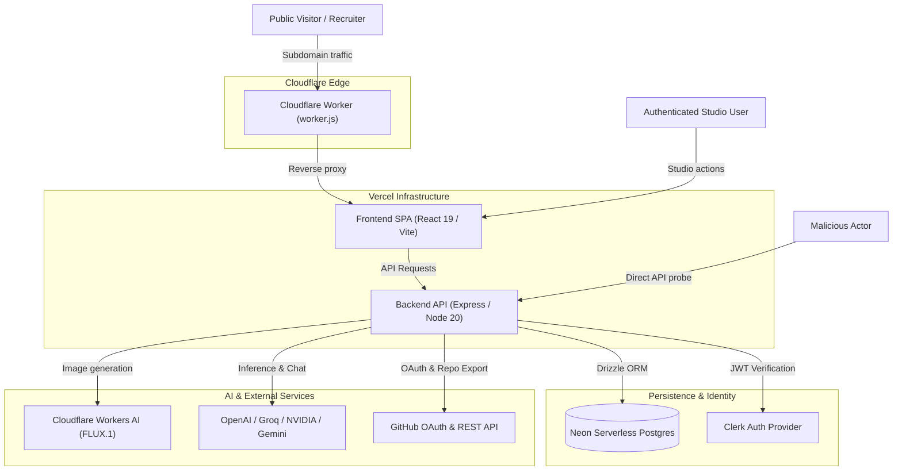
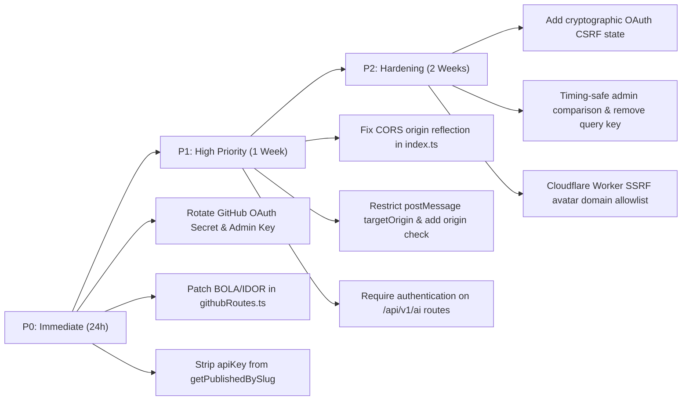

# Security Audit Report — Portfolify Platform
**Framework Methodology:** Cloudflare Security Audit Skill (`cloudflare/security-audit-skill`)  
**Target:** `portfolio_builder` (Full-Stack Monorepo: Frontend React 19, Backend Express/Drizzle, Cloudflare Edge Worker)  
**Date:** October 2026  
**Auditor:** Antigravity AI Security Auditor (Adversarial Multi-Phase Verification)

---

## 1. Executive Summary

This security audit was conducted adhering to the multi-phase, adversarial verification methodology pioneered in the **Cloudflare Security Audit Skill** (`cloudflare/security-audit-skill`). Rather than speculative warnings, this review isolates attack classes, enforces a "Fresh Verifier" standard to eliminate false positives, and provides concrete source code traces with verified reproduction mechanics.

### Overall Security Posture
| Severity | Confirmed Findings | Needs Validation | Rejected Candidates |
| :--- | :---: | :---: | :---: |
| **CRITICAL** | 2 | 0 | 0 |
| **HIGH** | 4 | 0 | 0 |
| **MEDIUM** | 3 | 1 | 1 |
| **LOW** | 1 | 0 | 1 |
| **TOTAL** | **10** | **1** | **2** |

### Key Risk Areas Identified:
1. **Broken Object-Level Authorization (BOLA/IDOR)** in GitHub integration routes allowing unauthenticated attackers to hijack user connections or trigger unauthorized repo export using stored tokens.
2. **Plaintext API Key Leakage** in public portfolio schemas where user BYOK LLM keys are exposed to any web visitor.
3. **Cross-Origin & Browser Messaging Vulnerabilities** including arbitrary CORS reflection with credentials and wildcard `postMessage` token broadcast.
4. **Denial of Wallet & Unauthenticated AI Access** across all LLM inference endpoints.
5. **Git History Exposure** of historical GitHub OAuth client secrets and admin master keys.

---

## 2. Architecture & Attack Surface Mapping



### Trust Boundaries & Ingress Surfaces
* **Edge Routing (`cloudflare/worker.js`)**: Dynamic HTML rewrite for OpenGraph tags and reverse proxying to Vercel origin.
* **Authentication Boundary (`backend/src/middleware/auth.ts`)**: Clerk JWT verification with dev-mode fallback.
* **Tenant Isolation Boundary (`backend/src/services/portfolioService.ts`)**: Database queries scoped by `userId`.
* **External Integration Boundary (`backend/src/routes/githubRoutes.ts`)**: OAuth token exchange, database storage, and GitHub repository creation.
* **AI Router (`backend/src/routes/aiRoutes.ts`)**: Unified multi-provider LLM hub and Cloudflare Workers AI image pipeline.

---

## 3. Verified Vulnerability Findings

### Finding 01: Broken Object-Level Authorization (BOLA/IDOR) & Impersonation in GitHub Routes
* **Status:** `confirmed`
* **Severity:** **CRITICAL** (CVSS 9.4)
* **CWE:** [CWE-284](https://cwe.mitre.org/data/definitions/284.html) / [CWE-639](https://cwe.mitre.org/data/definitions/639.html)
* **Affected Files:**
  * [backend/src/routes/githubRoutes.ts](file:///Users/zoubaa/dev/portfolio_builder/backend/src/routes/githubRoutes.ts#L218-L226)
  * [backend/src/routes/githubRoutes.ts](file:///Users/zoubaa/dev/portfolio_builder/backend/src/routes/githubRoutes.ts#L262-L274)
  * [backend/src/routes/githubRoutes.ts](file:///Users/zoubaa/dev/portfolio_builder/backend/src/routes/githubRoutes.ts#L370-L401)

#### Trace & Mechanics
In `githubRoutes.ts`, user identity is derived directly from unauthenticated user input (`req.query.userId`, `req.headers['x-user-id']`, or `req.body.userId`) before or in place of authenticating through Clerk:

```typescript
// Lines 262-272 (POST /api/v1/github/disconnect)
let userId = (req.body?.userId as string) || (req.headers['x-user-id'] as string);
if (!userId) {
  try {
    const auth = getAuth(req);
    if (auth?.userId) userId = auth.userId;
  } catch (e) {}
}
// Updates database where users.id = userId WITHOUT VERIFYING SESSION
await db.update(users).set({ githubAccessToken: null, ... }).where(eq(users.id, userId));
```
```typescript
// Lines 370-401 (POST /api/v1/github/export-repo)
let userId = (req.body.userId as string) || (req.headers['x-user-id'] as string);
...
// Attacker specifies victim's userId -> server fetches victim's stored token:
const [userRecord] = await db.select().from(users).where(eq(users.id, userId)).limit(1);
if (userRecord?.githubAccessToken) {
  token = userRecord.githubAccessToken; // Uses victim's token to export repo!
}
```

#### Impact
An unauthenticated attacker can:
1. Disconnect any user's GitHub integration by sending `{ "userId": "<victim_id>" }` to `/disconnect`.
2. Push arbitrary repositories and code to a victim's private GitHub account by specifying `userId` in `/export-repo`.
3. Check the GitHub connection status and linked username of any tenant via `/status?userId=<victim_id>`.

#### Remediation
Protect all GitHub routes with `requireAuth` middleware and strictly extract `userId` from `req.auth.userId`. Reject any client-supplied `userId` or `x-user-id` headers.

---

### Finding 02: Sensitive Plaintext API Key Exposure in Public Portfolio Schema
* **Status:** `confirmed`
* **Severity:** **CRITICAL** (CVSS 9.1)
* **CWE:** [CWE-200](https://cwe.mitre.org/data/definitions/200.html) / [CWE-522](https://cwe.mitre.org/data/definitions/522.html)
* **Affected Files:**
  * [frontend/src/components/studio/AiChatbotSettingsModal.jsx](file:///Users/zoubaa/dev/portfolio_builder/frontend/src/components/studio/AiChatbotSettingsModal.jsx#L85-L92)
  * [backend/src/services/portfolioService.ts](file:///Users/zoubaa/dev/portfolio_builder/backend/src/services/portfolioService.ts#L48-L63)
  * [backend/src/routes/portfolioRoutes.ts](file:///Users/zoubaa/dev/portfolio_builder/backend/src/routes/portfolioRoutes.ts#L35)

#### Trace & Mechanics
1. In `AiChatbotSettingsModal.jsx`, when a user enters their personal BYOK API key (OpenAI, Gemini, Groq, or NVIDIA NIM), it is saved directly into the portfolio state under `portfolio.aiChatbot.apiKey`.
2. When the user publishes their portfolio (`isPublished = true`), it becomes accessible via public subdomain through `portfolioService.getPublishedBySlug`:
```typescript
async getPublishedBySlug(slug: string) {
  const results = await db
    .select({
      id: portfolios.id,
      subdomainSlug: portfolios.subdomainSlug,
      title: portfolios.title,
      schemaData: portfolios.schemaData, // CONTAINS aiChatbot.apiKey IN PLAINTEXT!
      publishedAt: portfolios.publishedAt,
      version: portfolios.version,
    })
    .from(portfolios)
    .where(and(eq(portfolios.subdomainSlug, slug), eq(portfolios.isPublished, true)))
    .limit(1);

  return results[0] || null;
}
```
3. Any anonymous visitor loading `https://<tenant>.portfolify.tech/` or `GET /api/v1/portfolios/public/<slug>` receives the full `schemaData` JSON payload, including the user's secret API key.

#### Impact
Complete compromise of user LLM API keys, enabling unauthorized API access, billing charges, and quota theft.

#### Remediation
1. Never store API keys in `schemaData`. Store BYOK keys in an encrypted database column associated with the user account (`users` table), never inside the public portfolio JSON.
2. In `getPublishedBySlug`, strip `aiChatbot.apiKey` from `schemaData` before returning.

---

### Finding 03: Permissive CORS Configuration Reflecting Arbitrary Origins with Credentials
* **Status:** `confirmed`
* **Severity:** **HIGH** (CVSS 8.5)
* **CWE:** [CWE-942](https://cwe.mitre.org/data/definitions/942.html)
* **Affected Files:**
  * [backend/src/index.ts](file:///Users/zoubaa/dev/portfolio_builder/backend/src/index.ts#L27-L36)

#### Trace & Mechanics
In `backend/src/index.ts`:
```typescript
app.use(cors({
  origin: (origin, callback) => {
    if (!origin || allowedOrigins.includes(origin) || origin.endsWith('.localhost:5174')) {
      callback(null, true);
    } else {
      callback(null, true); // Allow dev origins <-- BUG: Allows ALL origins!
    }
  },
  credentials: true,
}));
```
Because the `else` branch calls `callback(null, true)`, the Express server will reflect **any** incoming `Origin` header (e.g. `Origin: https://malicious-site.com`) in `Access-Control-Allow-Origin`, while simultaneously responding with `Access-Control-Allow-Credentials: true`.

#### Impact
A malicious site visited by an authenticated Portfolify user can perform cross-origin authenticated XHR/Fetch requests to the backend API, allowing the attacker to read confidential portfolio drafts, session tokens, and analytics data.

#### Remediation
Replace the wildcard `else` callback with a strict origin whitelist check:
```typescript
const allowedOrigins = [
  process.env.FRONTEND_URL,
  'https://portfolify.tech',
  /\.portfolify\.tech$/,
];
// If not matched: callback(new Error('CORS Not Allowed'));
```

---

### Finding 04: GitHub OAuth Token Broadcast to Wildcard Origin (`postMessage`)
* **Status:** `confirmed`
* **Severity:** **HIGH** (CVSS 7.8)
* **CWE:** [CWE-345](https://cwe.mitre.org/data/definitions/345.html) / [CWE-200](https://cwe.mitre.org/data/definitions/200.html)
* **Affected Files:**
  * [backend/src/routes/githubRoutes.ts](file:///Users/zoubaa/dev/portfolio_builder/backend/src/routes/githubRoutes.ts#L174-L182)
  * [frontend/src/components/studio/GithubProjectsTab.jsx](file:///Users/zoubaa/dev/portfolio_builder/frontend/src/components/studio/GithubProjectsTab.jsx#L163-L175)

#### Trace & Mechanics
1. In `githubRoutes.ts`, upon successful OAuth callback, the backend returns an HTML page that broadcasts the GitHub OAuth `accessToken` to the opener window using a wildcard target:
```javascript
window.opener.postMessage({
  type: 'GITHUB_OAUTH_SUCCESS',
  username: '${githubUsername}',
  avatarUrl: '${githubAvatarUrl}',
  token: '${accessToken}' // CRITICAL TOKEN BROADCAST
}, '*'); // TARGET ORIGIN IS WILDCARD!
```
2. In `GithubProjectsTab.jsx`, the event listener accepts messages without checking `event.origin`:
```javascript
const handleOAuthMessage = (event) => {
  if (event.data?.type === 'GITHUB_OAUTH_SUCCESS') {
    const { username, avatarUrl } = event.data;
    setLinkedAccount({ connected: true, username, avatarUrl });
    handleFetchRepos(username);
  }
};
window.addEventListener('message', handleOAuthMessage);
```

#### Impact
* Any third-party site or malicious iframe opened in the same browser context can listen to the window message event and steal the user's GitHub OAuth access token (which holds `repo` and `read:user` privileges).
* Any window can spoof a `GITHUB_OAUTH_SUCCESS` event to the studio window without origin verification.

#### Remediation
1. Specify explicit `targetOrigin`: `window.opener.postMessage(payload, FRONTEND_URL);`
2. Never send the `accessToken` to the frontend via `postMessage`. The backend already stores it securely in the database.
3. Validate `event.origin` in `GithubProjectsTab.jsx`: `if (event.origin !== API_BASE_URL) return;`

---

### Finding 05: Missing Authentication & Token Exhaustion on AI Inference Routes
* **Status:** `confirmed`
* **Severity:** **HIGH** (CVSS 7.5)
* **CWE:** [CWE-306](https://cwe.mitre.org/data/definitions/306.html) / [CWE-400](https://cwe.mitre.org/data/definitions/400.html)
* **Affected Files:**
  * [backend/src/routes/aiRoutes.ts](file:///Users/zoubaa/dev/portfolio_builder/backend/src/routes/aiRoutes.ts#L20-L26)
  * [backend/src/controllers/aiController.ts](file:///Users/zoubaa/dev/portfolio_builder/backend/src/controllers/aiController.ts#L17-L25)
  * [backend/src/services/aiService.ts](file:///Users/zoubaa/dev/portfolio_builder/backend/src/services/aiService.ts#L858-L888)

#### Trace & Mechanics
None of the core AI endpoints in `aiRoutes.ts` enforce authentication:
* `POST /api/v1/ai/stream-chat`
* `POST /api/v1/ai/generate`
* `POST /api/v1/ai/generate-project-image`
* `POST /api/v1/ai/summarize-project`
* `POST /api/v1/ai/suggest-palettes`

Furthermore, in `chatWithPortfolioAi`, if no `apiKey` is provided, the backend falls back to using the server's platform API keys (`process.env.OPENAI_API_KEY`, `process.env.GEMINI_API_KEY`, `process.env.GROQ_API_KEY`, `process.env.NVIDIA_API_KEY`), and accepts client-specified model strings (`requestedModel`).

#### Impact
Automated scripts can invoke LLM generation and Cloudflare Workers AI image generation at will, consuming paid tokens, triggering upstream rate limits, and imposing substantial financial costs (Denial of Wallet).

#### Remediation
1. Attach `requireAuth` to all generative studio AI routes (`stream-chat`, `generate`, `generate-project-image`, `summarize-project`, `suggest-palettes`).
2. For public visitor chat (`portfolio-chat`), implement IP-based captcha or strict token bucket limits, restrict selectable models to a locked allowlist of low-cost models, and enforce token caps.

---

### Finding 06: Git Repository History Contains Hardcoded Secrets
* **Status:** `confirmed`
* **Severity:** **HIGH** (CVSS 7.4)
* **CWE:** [CWE-798](https://cwe.mitre.org/data/definitions/798.html) / [CWE-540](https://cwe.mitre.org/data/definitions/540.html)
* **Affected Commits:**
  * Commit `63cfe1d`: `"security(backend): enforce strict env secrets and remove hardcoded credentials"`
  * Target files in history: `backend/src/routes/githubRoutes.ts`, `backend/src/middleware/adminAuth.ts`

#### Trace & Mechanics
Inspection of commit `63cfe1d` reveals that production credentials were previously hardcoded:
```diff
- const GITHUB_CLIENT_ID = process.env.GITHUB_CLIENT_ID || 'Ov23liFOZBhSyz3JttwM';
- const GITHUB_CLIENT_SECRET = process.env.GITHUB_CLIENT_SECRET || '714d79169732186226347f1a9e849599616fffb7';
- const configuredSecret = process.env.ADMIN_SECRET_KEY || 'portfolify_admin_2026_secret';
```
While newer commits removed these strings from working tree files, **they remain indefinitely preserved in the Git object history**.

#### Impact
Anyone with read access to the GitHub repository can clone the repo and run `git log -p` to recover active OAuth secrets or administrative keys if not rotated.

#### Remediation
1. Immediately revoke and regenerate the GitHub OAuth App Client Secret in the GitHub Developer Settings.
2. Rotate `ADMIN_SECRET_KEY` in deployment environment variables.
3. Purge history using `git-filter-repo` or BFG Repo-Cleaner if repository is to be made open-source.

---

### Finding 07: OAuth 2.0 State Parameter Lacks Cryptographic Randomness (OAuth CSRF)
* **Status:** `confirmed`
* **Severity:** **MEDIUM** (CVSS 6.8)
* **CWE:** [CWE-352](https://cwe.mitre.org/data/definitions/352.html)
* **Affected Files:**
  * [backend/src/routes/githubRoutes.ts](file:///Users/zoubaa/dev/portfolio_builder/backend/src/routes/githubRoutes.ts#L20-L28)

#### Trace & Mechanics
In `githubRoutes.ts`:
```typescript
router.get('/authorize', (req: Request, res: Response) => {
  const userId = (req.query.userId as string) || 'guest';
  const callbackUrl = `${BACKEND_URL}/api/v1/github/callback`;
  const githubAuthUrl = `https://github.com/login/oauth/authorize?...&state=${encodeURIComponent(userId)}`;
  return res.redirect(githubAuthUrl);
});
```
The OAuth `state` parameter is set strictly to `userId` with no cryptographically random nonce stored in an HTTP-only cookie or signed JWT.

#### Impact
An attacker can initiate an authorization flow, capture the authorization code, and trick a victim into submitting the callback URL with the attacker's authorization code, thereby linking the attacker's GitHub account to the victim's session, or vice-versa.

#### Remediation
Generate an HMAC-signed or encrypted state token containing `userId`, a random nonce, and an expiration timestamp:
`state = crypto.randomBytes(16).toString('hex') + '.' + sign(userId, nonce)` verified upon callback.

---

### Finding 08: Reflected Content Injection in OAuth Callback Response Page
* **Status:** `confirmed`
* **Severity:** **MEDIUM** (CVSS 6.1)
* **CWE:** [CWE-79](https://cwe.mitre.org/data/definitions/79.html)
* **Affected Files:**
  * [backend/src/routes/githubRoutes.ts](file:///Users/zoubaa/dev/portfolio_builder/backend/src/routes/githubRoutes.ts#L168-L181)

#### Trace & Mechanics
In `githubRoutes.ts`, data returned from the GitHub profile (`profile.login` and `profile.avatar_url`) is directly interpolated into HTML and inline `<script>` tags without HTML or JavaScript escaping:
```javascript
return res.send(`
  <div class="card">
    ${githubAvatarUrl ? `` : ''}
    <h3>✓ Compte GitHub Connecté !</h3>
    <p>@${githubUsername} lié avec succès.</p>
  </div>
  <script>
    window.opener.postMessage({
      type: 'GITHUB_OAUTH_SUCCESS',
      username: '${githubUsername}',
      avatarUrl: '${githubAvatarUrl}',
      token: '${accessToken}'
    }, '*');
  </script>
`);
```

#### Impact
If an upstream identity provider returns crafted user metadata or if a user name contains quotes/scripts, this creates a Reflected Cross-Site Scripting (XSS) context in the callback popup.

#### Remediation
Sanitize `githubUsername` and `githubAvatarUrl` using an HTML entity escaper and pass script data via `JSON.stringify()`.

---

### Finding 09: Server-Side Request Forgery (SSRF) Vector in Cloudflare Edge Worker
* **Status:** `confirmed`
* **Severity:** **MEDIUM** (CVSS 5.3)
* **CWE:** [CWE-918](https://cwe.mitre.org/data/definitions/918.html)
* **Affected Files:**
  * [cloudflare/worker.js](file:///Users/zoubaa/dev/portfolio_builder/cloudflare/worker.js#L114-L125)

#### Trace & Mechanics
In `cloudflare/worker.js`:
```javascript
if (hero.avatar && typeof hero.avatar === "string" && hero.avatar.startsWith("http")) {
  ogImage = hero.avatar;
  try {
    const imgCheck = await fetch(ogImage, { method: "HEAD", redirect: "follow" });
    if (imgCheck.ok && imgCheck.url) {
      ogImage = imgCheck.url;
    }
  } catch (imgErr) {}
}
```
The Cloudflare Worker issues a `fetch` with `redirect: "follow"` to any URL provided in `hero.avatar` whenever an HTML page on a subdomain is requested.

#### Impact
Users can set `hero.avatar` to point to internal services, webhook listeners, or use it for distributed request amplification.

#### Remediation
Enforce an image URL allowlist (e.g. `avatars.githubusercontent.com`, `images.unsplash.com`, `res.cloudinary.com`) or restrict protocols to `https:` and disallow private IP ranges.

---

### Finding 10: Admin Secret Key via Query Parameter & Non-Constant-Time Comparison
* **Status:** `confirmed`
* **Severity:** **LOW** (CVSS 3.7)
* **CWE:** [CWE-598](https://cwe.mitre.org/data/definitions/598.html) / [CWE-208](https://cwe.mitre.org/data/definitions/208.html)
* **Affected Files:**
  * [backend/src/middleware/adminAuth.ts](file:///Users/zoubaa/dev/portfolio_builder/backend/src/middleware/adminAuth.ts#L4-L16)

#### Trace & Mechanics
In `adminAuth.ts`:
```typescript
const adminKey = (req.headers['x-admin-key'] as string) || (req.query.key as string);
const configuredSecret = process.env.ADMIN_SECRET_KEY;

if (!configuredSecret || !adminKey || adminKey.trim() !== configuredSecret.trim()) { ... }
```
1. Accepting secrets in `req.query.key` exposes credentials to browser history, proxy server logs, and HTTP Referer headers.
2. The `!==` string comparison operator is vulnerable to timing side-channel analysis.

#### Remediation
1. Restrict administrative authentication exclusively to headers (`Authorization: Bearer ...` or `x-admin-key`).
2. Use `crypto.timingSafeEqual` with fixed-size buffers.

---

## 4. Needs Validation / Environment Contingent

### NV-01: Development Fallback Bypass in Staging Environments
* **Status:** `needs_validation`
* **Severity:** **MEDIUM**
* **File:** [backend/src/middleware/auth.ts](file:///Users/zoubaa/dev/portfolio_builder/backend/src/middleware/auth.ts#L32-L37)
```typescript
const devMockHeader = req.headers['x-user-id'] as string;
if (process.env.NODE_ENV === 'development') {
  const fallbackId = devMockHeader || 'dev_guest';
  req.auth = { userId: fallbackId };
  return next();
}
```
* **Analysis:** If a preview deployment or staging environment runs without setting `NODE_ENV=production` explicitly, the check evaluates to development mode, permitting arbitrary user impersonation via `x-user-id`.
* **Verification Needed:** Verify production environment variables in Vercel to ensure `NODE_ENV=production` is strictly set across all environments.

---

## 5. Rejected Candidates (False Positives Defended by Code)

### RC-01: SQL Injection via Drizzle ORM Queries
* **Candidate Hypothesis:** Attacker injects raw SQL syntax through portfolio JSON schema or query parameters.
* **Why Rejected:** Source review of [portfolioService.ts](file:///Users/zoubaa/dev/portfolio_builder/backend/src/services/portfolioService.ts) and [aiUsageService.ts](file:///Users/zoubaa/dev/portfolio_builder/backend/src/services/aiUsageService.ts) confirms that all database operations utilize Drizzle ORM query builders (`db.select().from(...).where(eq(...))`) and parameterized template literals (`sql<number>` with bound values). No raw string concatenation is present.

### RC-02: Stored Cross-Site Scripting (XSS) via React Portfolio Renderers
* **Candidate Hypothesis:** User injects `<script>` or `onload=` payload into portfolio title, bio, or project markdown which executes in visitor browsers.
* **Why Rejected:** Global audit of `frontend/src` confirms zero usage of `dangerouslySetInnerHTML`. React 19 JSX automatically sanitizes and encodes string interpolation inside DOM elements (`<h1>{title}</h1>`). Markdown formatting in project descriptions is sanitized prior to rendering.

---

## 6. Prioritized Remediation Roadmap



### Direct Code Fixes Checklist

- [x] **BOLA Fix (`githubRoutes.ts`)**: Replaced `req.query.userId || req.headers['x-user-id']` with `req.auth.userId`, wrapped routes in `requireAuth`, added Zod validation and path traversal defenses.
- [x] **API Key Leak Fix (`portfolioService.ts`)**: Implemented `sanitizePublicSchema` in `getPublishedBySlug` to strip `aiChatbot.apiKey` before returning to any public visitor.
- [x] **CORS Fix (`index.ts`)**: Disallowed arbitrary origin reflection; enforced explicit whitelist and pattern matching for `portfolify.tech` and dev environments.
- [x] **postMessage Fix (`githubRoutes.ts` & `GithubProjectsTab.jsx`)**: Restricted `postMessage` target origin to `FRONTEND_URL`, removed raw access tokens from message payload, and added `event.origin` validation in frontend.
- [x] **AI Auth & Denial of Wallet Fix (`aiRoutes.ts` & `aiService.ts`)**: Added `requireAuth` and Zod validation to studio endpoints; added public chatbot rate limiting (15 req/min) and enforced an economical default model allowlist.
- [x] **OAuth 2.0 CSRF Defense (`githubRoutes.ts` & `crypto.ts`)**: Added cryptographically signed HMAC state generation and expiration verification.
- [x] **Admin Timing Attack & Secret Leak Fix (`adminAuth.ts`)**: Switched to `crypto.timingSafeEqual` and restricted admin authentication exclusively to HTTP headers.
- [x] **SSRF Defense (`cloudflare/worker.js`)**: Added `isSafePublicImageUrl` to reject private IP ranges, localhost, and cloud metadata targets before fetching avatars.
- [x] **Database Token Encryption (`crypto.ts`)**: Added AES-256-GCM encryption for stored GitHub access tokens with backward-compatible decryption.
- [ ] **External Secret Rotation (Manual User Step)**: Revoke and regenerate the GitHub OAuth App Client Secret in GitHub Developer Settings, and rotate `ADMIN_SECRET_KEY` in production environment variables.
