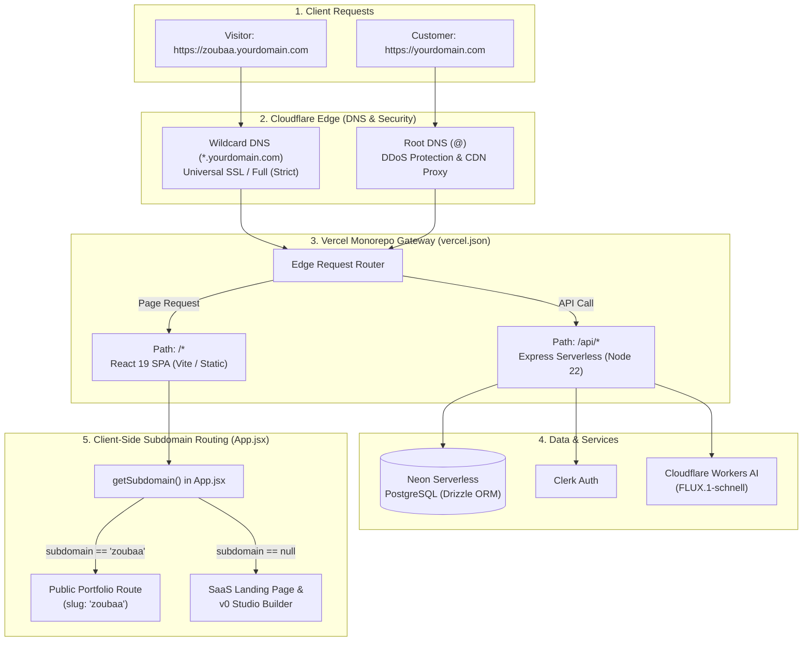

# Multi-Tenant Subdomain & Deployment Architecture

This document details the multi-tenant routing, Cloudflare DNS configuration, and Vercel serverless deployment architecture for **Portfolify**.

---

## 1. Global Flow Diagram



---

## 2. Cloudflare DNS Configuration

In your Cloudflare dashboard under your domain's **DNS** tab, configure the following records:

| Type | Name | Target / Content | Proxy Status | Description |
| :--- | :--- | :--- | :--- | :--- |
| **CNAME** | `@` (or domain) | `cname.vercel-dns.com` | **Proxied (Orange Cloud)** | Directs root traffic to Vercel |
| **CNAME** | `*` | `cname.vercel-dns.com` | **Proxied (Orange Cloud)** | Wildcard catches all user subdomains |

> [!IMPORTANT]
> **SSL/TLS Encryption Mode:**
> In Cloudflare $\rightarrow$ **SSL/TLS** $\rightarrow$ set the encryption mode to **Full (Strict)**. This ensures that HTTPS communication between Cloudflare and Vercel is end-to-end encrypted with valid SSL certificates.

---

## 3. Vercel Configuration (`vercel.json`)

The project uses a unified monorepo configuration in [`vercel.json`](file:///Users/zoubaa/dev/portfolio_builder/vercel.json):

```json
{
  "$schema": "https://openapi.vercel.sh/vercel.json",
  "version": 2,
  "installCommand": "npm --prefix backend install && npm --prefix frontend install",
  "buildCommand": "npm --prefix frontend run build",
  "outputDirectory": "frontend/dist",
  "rewrites": [
    {
      "source": "/api/(.*)",
      "destination": "/api/index.ts"
    },
    {
      "source": "/(.*)",
      "destination": "/index.html"
    }
  ]
}
```

### Serverless Express API Entrypoint
The root [`api/index.ts`](file:///Users/zoubaa/dev/portfolio_builder/api/index.ts) delegates all incoming `/api/*` traffic directly to the Express application instance in [`backend/src/index.ts`](file:///Users/zoubaa/dev/portfolio_builder/backend/src/index.ts).

When running under Vercel (`process.env.VERCEL`), the backend skips binding to a local port (`app.listen`) and exports the Express app handler directly to Vercel's serverless runtime.

---

## 4. Frontend Subdomain Resolution

The frontend dynamically detects the user's subdomain in [`frontend/src/utils/subdomain.js`](file:///Users/zoubaa/dev/portfolio_builder/frontend/src/utils/subdomain.js) and routes the visitor in [`frontend/src/App.jsx`](file:///Users/zoubaa/dev/portfolio_builder/frontend/src/App.jsx):

```text
Visitor loads URL
       │
       ▼
window.location.hostname
       │
       ├─► "zoubaa.yourdomain.com" ──► Slug: "zoubaa" ──► Mounts Published Portfolio
       ├─► "alex.yourdomain.com"   ──► Slug: "alex"   ──► Mounts Published Portfolio
       ├─► "yourdomain.com"        ──► Slug: null     ──► Mounts Landing Page / Studio
       ├─► "www.yourdomain.com"    ──► Slug: null     ──► Mounts Landing Page / Studio
       └─► "app.yourdomain.com"    ──► Slug: null     ──► Mounts Landing Page / Studio
```

### Local Development Testing
You can test multi-tenant subdomains locally without buying extra domains:
- Open: `http://zoubaa.localhost:5173`
- Or use `lvh.me` (which automatically resolves to `127.0.0.1`): `http://zoubaa.lvh.me:5173`

Both will resolve `slug="zoubaa"` and mount the portfolio preview!

---

## 5. CI / CD Skip Flags

When you want to deploy directly to Vercel without running unit tests or SonarQube, simply add **`[skip test]`** to your git commit:

```bash
# Skips both Frontend & Backend tests and SonarQube
git commit -m "fast deploy: update styling [skip test]"
git push
```

| Flag in Commit Message | Backend Tests | Frontend Tests | SonarQube Scan | Deployment |
| :--- | :---: | :---: | :---: | :---: |
| `[skip test]` or `skip test` | ⏭️ Skipped | ⏭️ Skipped | ⏭️ Skipped | 🚀 Runs Immediately |
| `[skip sonar]` | ✅ Runs | ✅ Runs | ⏭️ Skipped | 🚀 Runs Immediately |
| Normal Commit | ✅ Runs | ✅ Runs | ✅ Analyzed | 🚀 Runs if passed |
